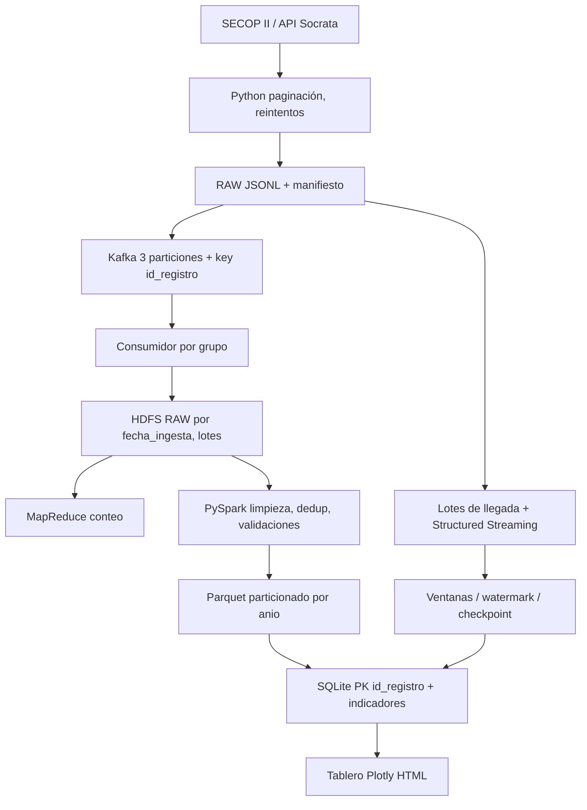

# Proyecto final G002 · SECOP II — Pipeline de datos masivos

**Pregunta:** ¿Cómo se distribuyen los contratos públicos colombianos por departamento, entidad y período, y dónde se concentra su valor?

**Fuente real:** [SECOP II - Contratos Electrónicos](https://www.datos.gov.co/Gastos-Gubernamentales/SECOP-II-Contratos-Electr-nicos/jbjy-vk9h). API: `https://www.datos.gov.co/resource/jbjy-vk9h.json`. Campo de clave: `id_contrato`. Campo temporal: `fecha_de_firma`. Objetivo: **30.000 registros descargados desde la API**. Los conteos de registros válidos pueden ser menores tras la limpieza y deduplicación. Los datos son una muestra ordenada por fecha, **no una muestra aleatoria representativa** de la contratación nacional.

**Usuarios de indicadores:** estudiantes de ingeniería de datos, analistas de contratación pública y ciudadanía. Los indicadores describen únicamente la muestra procesada, no el universo del SECOP.

## Arquitectura Lambda



Lambda: batch histórico por Spark y cálculos de ventana desde lotes con Structured Streaming. El flujo de streaming se implementa mediante **carpeta de llegada de lotes**, opción admitida explícitamente en la consigna; Kafka sigue siendo el bus de ingesta para la rama batch. No se afirma que el streaming lea Kafka cuando usa carpeta.

## Requisitos

- Docker Desktop con al menos 8 GB de RAM disponibles; Windows con WSL2 recomendado.
- Conexión a Internet para imágenes Docker, dependencias y API; Git para publicar.
- Todos los comandos se ejecutan desde la carpeta raíz del proyecto.

## Ejecución completa en Docker

**1.** Arrancar los servicios (primera vez descarga las imágenes, puede tardar):

```bash
docker compose up -d --build
```

**2.** Ingesta, Kafka y HDFS. Los servicios deben estar sanos/arrancados. Si HDFS tarda, repetir el paso en lugar de borrar los volúmenes.

```bash
docker compose exec worker python src/01_ingesta.py
docker compose exec worker python src/02_kafka.py
docker compose exec worker python src/03_consumidor_hdfs.py
```

**3.** Contar mediante Hadoop Streaming MapReduce (comando en el **host**, no en worker). El script descarga el jar oficial Hadoop 3.2.1 y lo copia al NameNode.

```bash
bash src/run_mapreduce.sh "/datalake/raw/SECOP_II/jbjy-vk9h/fecha_ingesta=$(date -u +%F)"
```

**Windows PowerShell:** consultar antes la fecha de `data/manifiesto.json`, y usar:

```powershell
$fecha = (Get-Content data/manifiesto.json | ConvertFrom-Json).fecha_ingesta
docker compose exec -T namenode hdfs dfs -ls "/datalake/raw/SECOP_II/jbjy-vk9h/fecha_ingesta=$fecha"
```

Para MapReduce en PowerShell, abrir **Git Bash** y ejecutar el comando `bash` de arriba con la fecha literal del manifiesto. También puede ejecutar los comandos del script manualmente.

**4.** Spark, validación, carga de servicio, streaming y tablero:

```bash
docker compose exec worker python src/05_spark_curada.py
docker compose exec worker python src/06_servicio.py
docker compose exec worker python src/09_watermark.py
docker compose exec worker python src/crear_lote_streaming.py
docker compose exec worker python src/07_streaming.py
docker compose exec worker python src/08_tablero.py
```

Abrir `tablero_secop.html` en el navegador. El tablero se alimenta de **SQLite** (tablas precalculadas), no calcula indicadores desde el JSON original.

**5.** Demostración de idempotencia del servicio y streaming (correr dos veces):

```bash
docker compose exec worker python src/06_servicio.py
docker compose exec worker python src/06_servicio.py
docker compose exec worker python src/07_streaming.py
docker compose exec worker python src/07_streaming.py
```

Comparar `data/reporte_idempotencia.json`, `data/reporte_streaming.json` y tablas SQLite antes/después. Si el productor Kafka se ejecuta dos veces **duplica mensajes en el tópico**; el proceso Spark aplica deduplicación y la tabla SQLite hace UPSERT por `id_registro`. Las ejecuciones de streaming con checkpoint persistido no vuelven a procesar los mismos archivos (su contenido y nombres no deben cambiar).

## Incremental y marca de agua

`09_watermark.py` conserva la fecha máxima de firma en SQLite; `10_incremental.py` consulta cambios con **7 días de solapamiento**. Los contratos de fechas antiguas modificados fuera de la ventana pueden escapar: no es CDC completo. Para integrarlo a la rama batch, use el archivo incremental como origen de `02_kafka.py` (variable `RAW_FILE`) y procese nuevamente Kafka→HDFS→Spark→servicio. La zona curada se reconstruye desde el histórico HDFS, de modo que mantiene idempotencia. La paginación por offset puede verse afectada si la API cambia durante la extracción; para un proyecto productivo se usaría snapshot o cursor por ID.

```bash
docker compose exec worker python src/10_incremental.py
```

## Validaciones y decisiones

| Problema | Decisión |
|---|---|
| ID faltante | Descartar y reportar |
| Fecha de firma ausente o inválida | Descartar; necesaria para series temporales |
| Valor de contrato negativo, nulo o ilegible | Descartar; no se puede sumar |
| Departamento/entidad en blanco | Etiquetar `SIN INFORMACIÓN`, sin inventar valores |
| ID repetido | Mantener la fila con fecha de ingesta más reciente |
| Tipos | Fecha SQL `date`; valor decimal representado como `double` para análisis exploratorio; para contabilidad definitiva usar `decimal` |
| Particionado Parquet | `anio` porque los filtros y series son temporales, sin crear miles de carpetas pequeñas |

**Validaciones críticas:** zona curada no vacía, ID no nulo, IDs únicos, fecha válida, valor >= 0. Fallar alguna detiene la fase antes de servicio. Los conteos y tamaños están en `data/reporte_calidad.json`. Validar conteo `evidencias/mapreduce_conteo.txt` contra `spark_mapreduce_equivalente`.

## Evidencias exigidas

Completar tras ejecutar realmente el proyecto: `docker compose ps`, `docker compose exec kafka kafka-topics --bootstrap-server kafka:29092 --describe --topic secop_contratos_raw`, salida del consumidor/HDFS, `hdfs dfs -ls`, conteo MapReduce vs Spark, `reporte_calidad.json`, conteos de SQLite y streaming repetidos, pantalla del tablero. Guardarlas en `evidencias/`. **No se adjuntan capturas fingidas ni se afirma que el entorno Docker se haya ejecutado aquí.**

## Entregables

- Todo este proyecto a GitHub, con `docker-compose.yml`, `Dockerfile`, `requirements.txt`, README y código.
- `data/manifiesto.json`, muestra `data/raw/...` y ejemplo Parquet generados en ejecución.
- `tablero_secop.html`, generado después de procesar datos.
- `presentacion_sustentacion.pptx` (máximo 8 diapositivas, plantilla lista para completar con cifras reales).
- `notebooks/SECOP_Colab.ipynb` para ingesta y validación inicial en Colab: **la ejecución completa de infraestructura se realiza en Docker**.

## Alcance y limitaciones

Este ZIP entrega una implementación íntegra de referencia y scripts de ejecución. **No incluye 30.000 registros ya descargados ni evidencias reales**: se generan en su computador al ejecutarlo con Internet. No se ha efectuado una prueba extremo a extremo con Docker desde este entorno. Una ejecución real y capturas son necesarias antes de entregar al docente.
